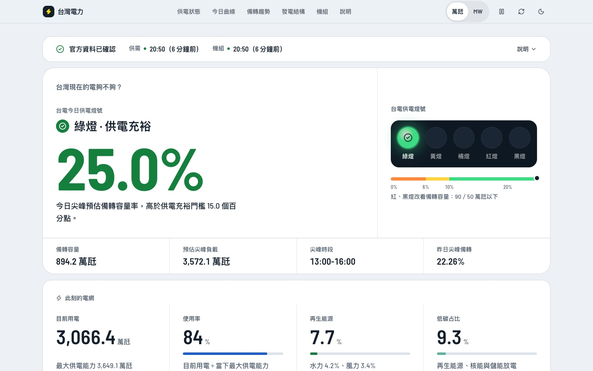

# 台灣電力即時看板

以台電官方開放資料呈現台灣供電狀態、資料新鮮度與發電結構的公共看板。

線上版：https://livejiaquan.github.io/taiwan-power-dashboard/



產品 mission、研究證據與 roadmap 見 [`docs/PRODUCT.md`](docs/PRODUCT.md)；production 的 freshness、fallback 與 validation 規則見 [`docs/DATA_TRUST_CONTRACT.md`](docs/DATA_TRUST_CONTRACT.md)。

## Features

- 首屏先回答「現在電夠不夠」：仿實體號誌的台電五燈號燈號板（燈位＋顏色＋形狀＋文字）、尖峰預估備轉容量率、0–25% 門檻尺。
- 資料時效細帶永遠在數字之前：兩份來源各自的時間與「幾分鐘前」；快照過期時燈號降亮度加斜線、標「非即時」，並提供台電官網連結。
- 「用電負載 ÷ 最大供電能力 ＝ 使用率」等式、燃料別 100% 堆疊條、北中南東各區用電。
- 今日用電曲線：台電 10 分鐘燃料別（或區域別）堆疊面積圖，疊加昨日負載、預估尖峰負載、最大供電能力與預估尖峰時段，未來時段淡化。
- 備轉容量率趨勢：近 10 日實績、今日預估與台電未來一週預測（斜線紋理標示預測）。
- 發電結構圓環圖／容量使用率、可搜尋篩選的 202 筆機組查詢、檢修與運轉限制清單。
- 每張圖都有一句白話說明、資料時間、表格檢視與 CSV 下載；單位可切換萬瓩／MW。
- 名詞與資料說明（備轉容量率、燈號、資料延遲、單位換算、驗證方法）與資料來源下載區。
- live、delayed、stale、unavailable 由官方來源時間決定，頁面每 15 秒自行重算；可暫停自動更新（WCAG 2.2.2）。
- 淺色／深色模式、手機單欄、鍵盤操作、`prefers-reduced-motion`；axe 檢測 WCAG 2.1 AA 0 違規（自動化測試把關）。
- Fail-closed：核心快照驗證失敗不發布；今日曲線等補充資料逐區塊獨立失敗，不影響核心數字，也不以示範資料代替。

## Tech Stack

- Vite + React 19 + Tailwind CSS v4，shadcn/ui 風格元件（Radix Tooltip/Tabs/Accordion、lucide-react 圖示）。
- ECharts（按需註冊、延遲載入、SVG renderer）。燃料配色參考 Electricity Maps、Open Electricity 與 grid.iamkate.com 慣例；圖表呈現參考 CAISO Today's Outlook、東京電力でんき予報與英國 NESO。
- 資料驗證、新鮮度與呈現規則是框架無關的純 JS 模組（`js/`），由 `node --test` 直接測試；React 只訂閱 `js/dashboard-controller.js` 的狀態。
- 品質工具：ESLint 9（react-hooks、jsx-a11y）、`node --test`、Playwright e2e（四種新鮮度狀態 × 桌機／手機 × 淺色／深色）加 axe 無障礙檢測，於 `.github/workflows/ci.yml` 執行。
- 設計與工程的調查依據見 [`docs/RESEARCH.md`](docs/RESEARCH.md)；介面改版的同類產品研究（Electricity Maps、GridStatus、EIA、NESO、でんき予報等）見 [`docs/design-research.md`](docs/design-research.md)。
- 字體：Barlow／Barlow Semi Condensed（Fontsource 自架、OFL-1.1，只載 Latin 子集）搭配系統中文字體；冷調鋼灰與夜藍雙主題。設計語言（字體、色彩、間距、動效）與對比實測見 [`docs/design-research.md`](docs/design-research.md#設計語言)；使用者研究與裝置評估見 [`docs/ux-research.md`](docs/ux-research.md)。
- 效能：首屏以外的內容與 ECharts 分塊延後載入、背景時間切片渲染；HTML 先畫出骨架，資料快照與 JS 並行下載。

## Data Sources

| Dataset | Source |
| --- | --- |
| 今日電力資訊 | `https://service.taipower.com.tw/data/opendata/apply/file/d006020/001.json` |
| 各機組發電量即時資訊 | `https://service.taipower.com.tw/data/opendata/apply/file/d006001/001.json` |
| 今日／昨日燃料別用電曲線 | `https://www.taipower.com.tw/d006/loadGraph/loadGraph/data/loadfueltype.csv`、`loadfueltype_1.csv` |
| 今日區域別用電曲線 | `https://www.taipower.com.tw/d006/loadGraph/loadGraph/data/loadareas.csv` |
| 本年度每日尖峰備轉容量率 | `https://service.taipower.com.tw/data/opendata/apply/file/d006002/001.csv` |
| 未來一週電力供需預測 | `https://service.taipower.com.tw/data/opendata/apply/file/d006007/001.csv` |

Government dataset pages:

- https://data.gov.tw/dataset/162595
- https://data.gov.tw/dataset/8931

資料提供：台灣電力股份有限公司；依[政府資料開放授權條款第 1 版](https://data.gov.tw/license)使用。本產品不代表台電背書。

## Run Locally

```bash
npm install
npm run dev
```

Open `http://127.0.0.1:4173`. The Vite dev server mounts a same-origin proxy at `/api/power-data` (see `server/power-api.js`) that fetches and validates both official Taipower feeds.

## Test

```bash
npm run lint
npm test            # data trust, parsers, controller (node --test)
npm run test:e2e    # vite build + Playwright e2e + axe (needs Chromium: npx playwright install chromium)
```

## Production Build

Requires Node.js 22–26 and live access to both official Taipower feeds:

```bash
npm run build      # vite build → build/web, then stage site + official snapshot into dist/
npm run preview    # serve dist/ locally
```

`scripts/build-static-site.js` stages the built app and a freshly validated snapshot before replacing `dist/`. If validation or fetch fails, it exits non-zero without replacing the last successful build or publishing sample data. It then tries the supplementary intraday curves (`scripts/build-curve-data.js` → `api/curves.json`); each curve section fails independently and never blocks the core snapshot.

## Project Structure

```text
taiwan-power-dashboard/
├── index.html                  # Vite entry
├── vite.config.js
├── src/                        # React UI
│   ├── App.jsx
│   ├── components/             # status card, mix, unit explorer, ui/ primitives
│   ├── hooks/                  # dashboard controller + theme bindings
│   └── lib/                    # fuel palette, utilities
├── js/                         # framework-agnostic data layer (tested directly)
│   ├── api.js                  # same-origin fetch, cache, provenance checks
│   ├── dashboard-controller.js # loading, auto refresh, freshness re-aging
│   ├── dashboard-presenter.js  # trust copy, reserve headline, formatting
│   ├── curves-api.js           # optional intraday curves (client validation)
│   ├── data-freshness.js
│   ├── freshness-clock.js
│   ├── power-curves.js         # loadfueltype/loadareas/d006002/d006007 parsers
│   └── power-data.js           # Taipower parsing + validation
├── server/power-api.js         # dev/preview proxy (Vite plugin)
├── scripts/                    # static snapshot + site build
├── data/sample-power-data.js   # test fixture only; never shipped
├── docs/
└── tests/                    # node --test suites, fixtures/, e2e/ (Playwright + axe)
```

## Notes

The dashboard uses a same-origin dev proxy at `/api/power-data` (a Vite plugin) because Taipower's official JSON endpoints do not consistently expose browser-friendly CORS headers. GitHub Pages never probes that server-only route or fetches Taipower directly; it reads the same-origin `api/power-data.json` snapshot produced by CI. If a refresh fails, a last-known-good browser/static snapshot may remain visible only with its original source age and a delayed/stale label. Missing, invalid, future-dated, sample, or over-24-hour data becomes unavailable.

## GitHub Pages

This repository includes a GitHub Actions workflow at `.github/workflows/pages.yml`.
On push to `main`, manual dispatch, and a nominal 10-minute schedule, the workflow:

1. installs dependencies and runs the Node test suite;
2. builds the React app with Vite;
3. fetches the latest Taipower JSON from GitHub Actions;
4. validates both source payloads and writes a static `api/power-data.json` snapshot;
5. force-publishes the static build to the `gh-pages` branch.

GitHub Actions scheduled jobs are best effort and can be delayed or skipped. The UI therefore derives freshness only from both official source timestamps, never from the cron setting, build time, or browser cache time. A failed build leaves the previous deployment in place; the client will visibly age it into delayed/stale/unavailable states. Local development uses the same-origin Vite proxy at `/api/power-data`.
