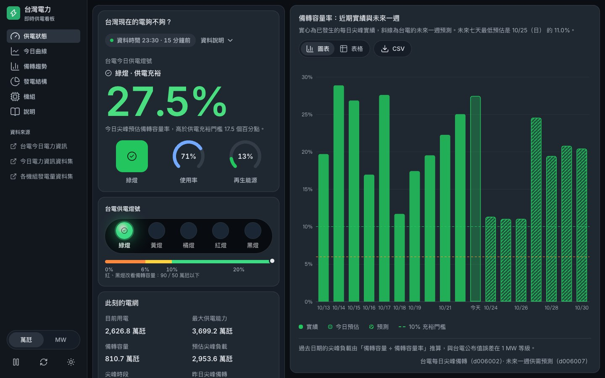
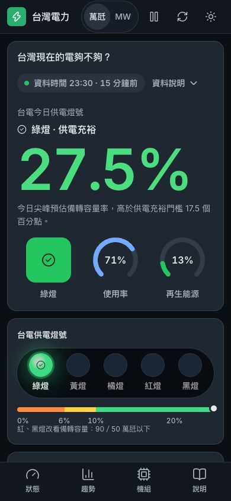

# 台灣電力即時看板

用台電的官方開放資料，讓一般人快速看懂台灣現在的供電狀況：今天的供電燈號、備轉容量率、發電結構與每一部機組的輸出，並且清楚標示資料的時間。

**線上版：https://livejiaquan.github.io/taiwan-power-dashboard/**





## 功能

- **一眼看懂**：台電官方五色燈號（綠、黃、橘、紅、黑）、今日尖峰預估備轉容量率與 0–25% 門檻尺，狀態同時用顏色、圖示與文字表示。
- **資料時間在數字旁邊**：即時、稍舊、過舊、超過 24 小時四段，由瀏覽器依台電資料本身的時間計算。過期時仍保留最後一筆資料。
- **圖表**：今日 10 分鐘用電曲線（燃料別或區域別，疊加昨日、預估尖峰與最大供電能力）；近 10 日實績加未來一週的備轉容量率預測；發電結構。
- **機組**：202 筆機組可搜尋、依燃料別篩選，另有檢修與運轉限制清單。
- **資料可取用**：每張圖都有白話說明、表格檢視與 CSV 下載；單位可切換萬瓩／MW。
- **無障礙與可用性**：深色（預設）與淺色、手機版面、鍵盤操作、`prefers-reduced-motion`；自動化的 axe 檢測 WCAG 2.1 AA 無違規。
- **資料不可信就不顯示**：核心資料驗證失敗時不發布；曲線等補充資料各自獨立失敗，不影響核心數字，也不用示範資料代替。

## 技術

Vite、React 19、Tailwind CSS v4、Radix UI、Apache ECharts，圖示用 Lucide，字體是 Inter。

資料的驗證、新鮮度計算與呈現文字都放在不依賴框架的 `js/` 模組，直接用 `node --test` 測試；React 只負責顯示。規則見 [`docs/DATA_TRUST_CONTRACT.md`](docs/DATA_TRUST_CONTRACT.md)，設計取捨見 [`docs/design-notes.md`](docs/design-notes.md)。

## 資料來源

| 資料 | 來源 |
| --- | --- |
| 今日電力資訊 | `https://service.taipower.com.tw/data/opendata/apply/file/d006020/001.json` |
| 各機組發電量即時資訊 | `https://service.taipower.com.tw/data/opendata/apply/file/d006001/001.json` |
| 今日／昨日燃料別用電曲線 | `https://www.taipower.com.tw/d006/loadGraph/loadGraph/data/loadfueltype.csv`、`loadfueltype_1.csv` |
| 今日區域別用電曲線 | `https://www.taipower.com.tw/d006/loadGraph/loadGraph/data/loadareas.csv` |
| 本年度每日尖峰備轉容量率 | `https://service.taipower.com.tw/data/opendata/apply/file/d006002/001.csv` |
| 未來一週電力供需預測 | `https://service.taipower.com.tw/data/opendata/apply/file/d006007/001.csv` |

資料集頁面：[今日電力資訊](https://data.gov.tw/dataset/162595)、[各機組發電量](https://data.gov.tw/dataset/8931)。

資料提供：台灣電力股份有限公司，依[政府資料開放授權條款第 1 版](https://data.gov.tw/license)使用。本專案與台電無隸屬關係，也不代表台電背書；請以台電公告為準。

## 本機執行

需要 Node.js 22–26。

```bash
npm install
npm run dev
```

打開 `http://127.0.0.1:4173`。開發伺服器在 `/api/power-data` 提供同源代理（`server/power-api.js`），即時抓取並驗證台電的兩份資料，因為台電的 JSON 並不一致地提供瀏覽器可用的 CORS 標頭。

### 測試

```bash
npm run lint
npm test            # 資料驗證、解析、控制器（node --test）
npm run test:e2e    # 建置後跑 Playwright 端對端測試與 axe（需要先 npx playwright install chromium）
```

### 正式建置

```bash
npm run build       # vite build，再把網站與剛驗證過的官方資料快照放進 dist/
npm run preview     # 在本機預覽 dist/
```

建置需要連得到台電的資料。`scripts/build-static-site.js` 會先驗證資料才取代 `dist/`：驗證或抓取失敗時以非零狀態結束，不會用示範資料頂替。

## 部署

`.github/workflows/pages.yml` 在推送到 `main`、手動觸發與定時排程時執行：安裝套件、跑測試、建置、抓取並驗證台電資料、把靜態網站推到 `gh-pages` 分支。GitHub 的排程是盡力而為，實際可能數小時才跑一次，所以網頁一律用台電資料本身的時間判斷新舊，不看排程、建置或快取時間。

## 專案結構

```text
index.html                 Vite 入口與載入前的版面骨架
public/                    favicon、apple-touch-icon、品牌標記
src/                       React 介面
  components/              頁面區塊與 ui/ 基礎元件
  hooks/                   控制器與主題
  lib/                     燃料配色、單位、工具函式
js/                        不依賴框架的資料層（驗證、新鮮度、呈現文字）
server/power-api.js        開發與預覽用的同源代理（Vite 外掛）
scripts/                   靜態快照與網站建置
data/                      測試用範例資料（不會被發布）
docs/                      資料可信契約、設計筆記、截圖
tests/                     單元測試與 Playwright／axe 端對端測試
```

## 授權

[MIT](LICENSE)
